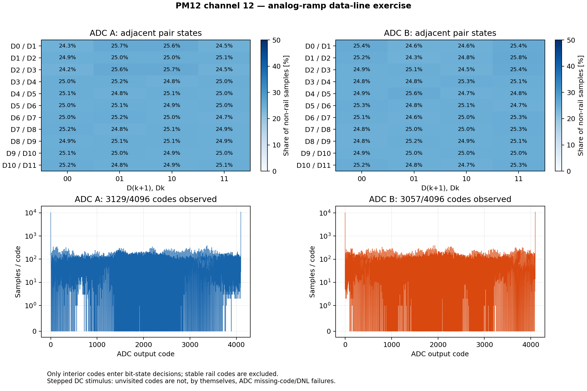

# ADC data-line exercise: adjacent bit bridges and stuck bits

Physical channel12, ADC A and B: PASS2026-11-07. The existing PM/Kasli SRAM
images were retained (PM c7c42d28). No gateware, MCU, CPLD, clock profile or
configuration flash writes. Stimulus uses MOD-DAC-28 over existing SCPI, the
CFD_SIM analog mux and the existing PM IPbus acquisition.

## What is checked

The AD9236 has12 parallel data outputs; reference:
[official data sheet](https://www.analog.com/media/en/technical-documentation/data-sheets/ad9236.pdf).
We test the entire selected ADC→CPLD→Kintex path, not electrical resistance at
an individual chip pin. The priority pairs are D0/D1 through D10/D11.

For every bit, both0 and1 must be well represented. For every adjacent pair,
all four states00/01/10/11 must occur (encoded as upper/lower D(k+1),Dk).
Each state needs at least64 observations, at least2% of the interior samples,
and at least8 observations on each of at least3 distinct DAC settings.
That prevents a few glitches from clearing an otherwise tied pair. Stable rail
codes0/4095 are excluded from these decisions. A successful sweep also requires
at least16 distinct settings, at least4096 interior samples and a mean-code
span of at least3000. Inadequate excitation is INCONCLUSIVE, not PASS.

Equal neighbors, nearly always equal neighbors and stuck-bit signatures are
reported separately. These indicate a possible data-path fault, not its exact
physical location. Swapped pins, intermittent faults and timing margin are not
proven by this test. A resistive bridge can require additional electrical tests.

## Physical result

257 equally spaced requested differential levels−1.2..+1.2V, common mode1V,
CH0/CH1 legs0.4..1.6V, both ADC paths in turn. The existing per-pin3.3V hard
client guard remains. About1022 independent ADC samples per4096-word buffer.

| Quantity | ADC A | ADC B |
|---|---:|---:|
| Adjacent pairs passed | 11/11 | 11/11 |
| Individual bits passed | 12/12 | 12/12 |
| Non-rail samples | 241856 | 241760 |
| Minimum distinct settings supporting any pair state | 61 | 61 |
| Observed state fractions, all pairs | 24.19–25.73% | 24.25–25.75% |
| Distinct codes visited | 3129/4096 | 3057/4096 |

All514 retained raw buffers were independently decoded:2,105,344 words,
EV selector tags correct, every STR interval4 capture samples, every histogram
exact, capture generations contiguous. No stuck bits or adjacent equality
signatures were observed. The six algorithm tests also detect all11 possible
adjacent hard ties, either dominating bit, and every stuck-high/stuck-low bit.

The primary physical acquisition used the existing scanner. Analysis was then
strengthened to require at least2% occupancy per state and rerun offline on the
same retained buffers. Executed acquisition sources and final analysis sources
are archived separately. The old101-point sweep was also checked offline and
exercised all four adjacent-pair states.

## Histogram and sine-wave interpretation

This is a **stepped DC sweep**, not a complete4096-code density qualification.
Unvisited codes alone are not missing-code/DNL failures. The finite voltage
grid, DAC resolution, analog noise and previously observed four-sample pattern
all shape the histogram. No ADC INL/DNL, ENOB or exact analog gain claim follows.

A continuous slow triangle/ramp can be used for a denser code-density test.
A sine is also useful, but its ideal histogram is arcsine-shaped (more samples
near extrema), not flat; coherent phase repetition and clipping must be handled.
For static adjacent-line exercise, the current controlled DC sweep avoids
requiring an additional waveform generator.



## Repeat on a wired simulator

Use the existing Optiplex Python environment with serial/USB support:

```
/home/codex-hil/kasli-diot-bringup/.venv/bin/python diagnostics/pm12/cfd_simulator/adc_line_test.py --acquire --afe 12 --points 257 --out NEW-DIRECTORY
```

The scanner accepts `--afe 1..12`, maps the corresponding TCA branch and reads
that physical channel's FPGA buffer. Only channel12 is physically qualified so
far; for new modules first confirm the analog USB pair is connected there.
No FPGA build is needed to select another AFE. Both ADC A/B are tested.

Offline analysis, with no hardware access:

```
python3 diagnostics/pm12/cfd_simulator/adc_line_test.py --report SCAN/status.json --out NEW-ANALYSIS-DIRECTORY
python3 diagnostics/pm12/cfd_simulator/validate_adc_lines.py SCAN --out raw-validation.json
```

The live wrapper runs raw validation automatically. Acquisition holds the
PM12/Atmel/Kasli and both local+station2 DAC leases, checks MCU S/N1803 and
PGOOD, validates the known FPGA ABI/build, uses break-before-make ADC routing,
and retains raw buffers. It leaves CH0=CH1=1V, other DAC channels unchanged,
integrator disabled, external input on ADC A, monitor inhibited, TCAs restored.
Error handling attempts zero-voltage DAC parking independently of I2C cleanup.
This test does not issue shared HDMI SPI transactions or alter PM phase DACs.
