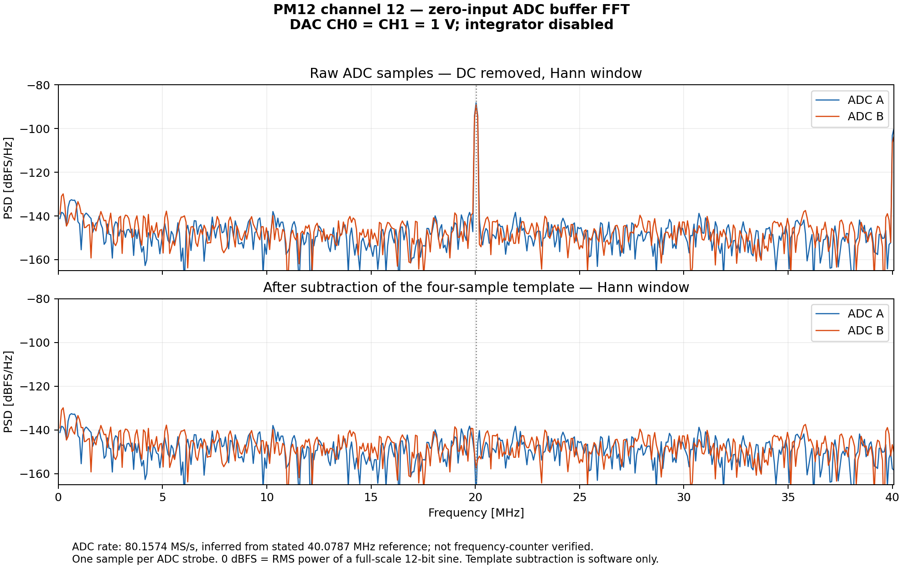

# External differential DAC characterization of PM12 channel12

Physical test PASS, 2026-11-06. Same PM12 S/N1803 channel12/CFD_SIM used for TDC.
Resident FPGA a27baa3e and Kasli SFP1/SFP2 bridge were retained throughout.
No firmware, FPGA/CPLD programming, resets, PLL or EEPROM writes.

## Connection and controls

MOD-DAC-28 CH0/CH1 are the external differential pair through USB to CFD_SIM J8.
Both1V give zero differential; define requested Vdiff=CH0-CH1 and Vcm=1V.
Existing SCPI number entities are used unchanged. Instrument identified as
MODULIQ,MOD-DAC-28,FIT-CTRL-6825DD4C49E4,1.0, project28/revision16, mDNS
fit-mod-dac-28.local, observed192.168.2.17, Ethernet MAC68:25:dd:4c:49:e7.
The FIT client rejects nonfinite values and any per-output command outside
0..3.3V BEFORE writing either leg. Maximum actually commanded during this test
was1.6V; minimum sweep setting0.4V. Startup values were read as allzero.

Per cfd_sim.pdf, physicalAFE12 routes TCA71 mask08, MCP23017@20 BANK0:
- GPA7 HIGH drives T1 and pulls Integrator_PDn LOW, disabling the integrator.
- GPA3 HIGH inhibits the shared DC monitor throughout; GPA5/6 remain inputs.
- GPB5 HIGH inhibits MAX4053 during selector changes (break-before-make).
- GPB7/6 both HIGH select ADC A; both LOW select ADC B. Clear GPB5 to connect.
- CPLD EV0 selects ADC A readout; EV1 selects ADC B. Cross-bank probe confirmed
  the selected path response. The unselected, undriven ADC readings drifted and
  are preserved in the probe receipt, not used for gain/noise fits.

GPIO latch/direction and GPA7 pin levels were checked. Integrator_PDn voltage
itself and analog isolation with INH HIGH were not independently measured.

## Acquisition and results

Physical4096-sample Kintex ADC buffers were read over native IPbus.
ADC samples are selected as the final320MSPS record before each next STR rising
edge, about1022/1023 ADC samples per capture. All selector tags were checked;
median STR period4 capture samples. Raw captures are preserved.

101 points per ADC over requested differential−1..+1V in20mV steps, plus12
edge points per ADC out to±1.2V. A small±20mV cross-bank probe preceded the scan.
Vcm stayed1V; both legs were set symmetrically as1±Vdiff/2.

| Result | ADC A | ADC B |
|---|---:|---:|
| Mean at CH0=CH1=1V | 2051.597 | 2055.338 |
| Linear-fit gain, codes / commanded V | −1859.150 | −1860.419 |
| Maximum absolute fit residual, codes | 5.582 | 6.106 |
| Total RMS at zero differential, codes | 19.857 | 17.406 |
| RMS after four-phase template subtraction, codes | 0.491 | 0.524 |

Both ends reach0/4095. Full saturation occurs around requested±1.12..±1.16V,
with asymmetric onset because the four-sample pattern broadens the transition.
The same four-sample pattern appears at zero input and is coherent with the
ADC sampling sequence. Its physical source has NOT been isolated. The software
subtraction does not alter the hardware or establish intrinsic ADC noise.

The voltage axis is SCPI setpoints, not measured DAC output voltage. These are
whole DAC/cable/mux/ADC/capture-chain characteristics, not calibrated ADC gain,
INL, DNL or ENOB. The older signed-candidate fields in receipts were exploratory;
plots/statistics use the raw12-bit offset-binary code, center2048.

[English plots](evidence-adc-dc-20261106/adc-dc-characterization.png),
[PDF](evidence-adc-dc-20261106/adc-dc-characterization.pdf),
[CSV](evidence-adc-dc-20261106/dc.csv),
[summary](evidence-adc-dc-20261106/summary.json),
[raw capture archive](evidence-adc-dc-20261106/raw-captures.tar.gz).

## Repeat

On Optiplex, with the resident setup already operational:

```
python3 diagnostics/pm12/cfd_simulator/adc_dc_scan.py --probe --out NEW-DIRECTORY
python3 diagnostics/pm12/cfd_simulator/adc_dc_scan.py --out ANOTHER-NEW-DIRECTORY
```

Default full scan is−1..+1V. --differences accepts an explicit list, e.g.
--differences -1.2 -1.1 0 1.1 1.2. All points are validated before acquiring
hardware. Source code checks both legs against the fixed3.3V ceiling.

The runner holds PM12/Atmel/Kasli plus ESP32-6825dd4c49e4/lattice-VER00001
leases on Optiplex and the corresponding DAC leases on station2 for the entire
operation. Remote hostname and SCPI identity/setup are verified. PGOOD is checked
before I2C setup and each step; no competing I2C master is enabled in FPGA.
Use the existing shared station2 SSH key; no keys or credentials are embedded.

Success leaves CH0=CH1=1V, other channels unchanged, integrator disabled,
external pair connected to ADC A, monitor inhibited, both TCAs disconnected.
A final physical ADC A zero capture is retained in BRAM (generation251 in this
run, mean2051.781 codes). Leases are released, no background control process.
On errors the runner independently attempts to park the connected DAC pair
to0V before GPIO restoration, and reports cleanup failures. This also avoids relying on I2C for muting after a
PM power fault. No firmware-wide voltage limit is changed; the3.3V ceiling is
implemented by this FIT client.

Initial handoff: ~/workspaces/mod-dac-28-support/docs/FIT-DAC-HANDOFF.md.
Official ADC reference: https://www.analog.com/media/en/technical-documentation/data-sheets/ad9236.pdf .

## Offline buffer FFT

`plot_adc_fft.py` analyzes the zero-input buffers (DAC CH0=CH1=1 V) from
`dc-scan-01`, separately for ADC A and B on physical channel 12. Extract one
sample immediately before each rising ADC strobe; verified spacing is four
FPGA capture records. Retain 1020 samples (complete four-sample periods).
The ADC rate is inferred as 2 × stated 40.0787 MHz = 80.1574 MS/s; this was
not checked with a frequency counter. FFT bin spacing is 78.586 kHz.

| Component | ADC A RMS [codes] | ADC B RMS [codes] |
|---|---:|---:|
| Fs/4 = 20.03935 MHz | 19.242 | 17.085 |
| Fs/2 = 40.07870 MHz | 4.899 | 3.280 |
| Total, DC removed | 19.862 | 17.405 |
| Four-sample template removed | 0.490 | 0.524 |

Tone RMS uses the coherent unwindowed FFT with correct one-sided/Nyquist
normalization; Parseval error is below 1e-12 codes squared. The plotted PSD
uses a Hann window, normalized to a full-scale 12-bit sine RMS power.
Template subtraction is software processing and does not identify or remove
the physical cause. These are existing captured data, with no new hardware
changes. Source buffer SHA-256 hashes and statistics are in
`evidence-adc-fft-20261106/fft-summary.json`; the buffers themselves are in the
previous `evidence-adc-dc-20261106/raw-captures.tar.gz` archive.


