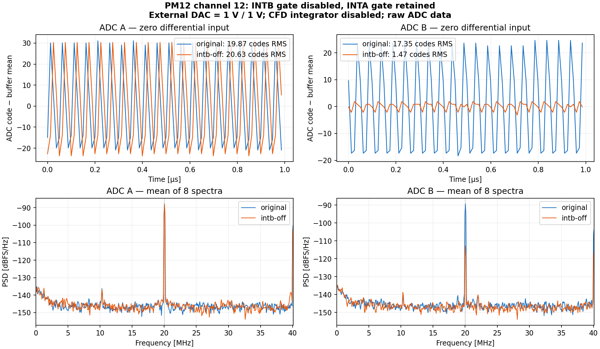

# INTB gate isolation on physical channel 12

**Current state, 2026-11-12: original INTA and INTB operation restored.**
Owner requested ending the INTB-off experiment. Only CPLD12 was programmed
with the archived original-gate vector. Vendor verification and two complete
array reads confirm all12 CPLDs match the original baseline; CPLD1..11
nonvolatile contents are unchanged. Kasli gate capture before/after: INTA
682→683 rising edges; INTB0→682, over32760samples per lane. PGOOD and MCU1803 /
FPGA DNA3A17A1B402212223 were verified. No FPGA/MCU programming, DAC writes
or analog routing changes. Kasli capture stopped and leases released.
[Restoration receipt](evidence-intb-restored-20261112/status.json) and
[raw captures, programming/verification logs](evidence-intb-restored-20261112/).
The INTB-off measurements below are historical; their experimental image is
no longer the retained hardware state.


2026-11-08 experiment: retain the original INTA/P53 divider waveform for the
CFD_SIM phase shifter, hold INTB/P54 LOW. Only CPLD12 nonvolatile configuration
is changed; the other eleven CPLDs, PM FPGA, Kasli FPGA and MCU images remain.
The CPLD ADC mux, EV chain, CLK40 and forwarded ADC clock are unchanged.

The source defaults to the original two-gate behavior (`INTB_ENABLE=true`).
Build the experimental image on Dell, in a new job directory, with
`PM12_CPLD_INTB_ENABLE=false bash cpld/build.sh`. This emits the XST generic
override; simulation covers both generic values. The generic build's 55,341
fuses match the separately built experimental source snapshot exactly.

Generate vendor iMPACT SVF vectors using the documented 13-device chain and
convert with `adc/tools/svf_to_tcl.py`. For this experiment program **position12
only**, corresponding to physical CPLD12 (position13 is the Kintex).
Do not use the generic all-twelve-device programming export unchanged.
Archive three converted vectors: `program.tcl` (INTB off), `restore.tcl`
(original gates, channel12 only), `verify-original.tcl` (verify all original
CPLDs). The evidence archive retains the actual vectors and logs.

## Measurement

Board PM12-K7-3A17A1B402212223, MCU serial1803, resident integrated FPGA c7c42d28.
MOD-DAC-28 CH0/1 remain1V/1V; no DAC writes. Existing CFD integrator-disable and
monitor-inhibit settings are checked. The external differential pair is routed
to A and B in turn, with the same selector sequence before/after programming.

Each state records eight4096-word raw buffers per ADC over IPbus, one sample
per ADC strobe after bounded-timing/coherency validation. Kasli records32760
raw input samples per gate, validating the phase records against the raw bits.
Its capture directly checks that INTA pulses persist and INTB is constant LOW.
Twice-read CPLD arrays before/after must differ on channel12 only. PGOOD, board
identity, unchanged DAC setpoints and restored external-ADC-A routing are checked.

A first run acquired the comparison but its final read-only DAC query encountered
an idle SCPI disconnect. The runner automatically restored the original CPLD;
full before/after array comparison verified restoration. The retained failed
receipt is not relabeled PASS. The subsequent complete repeat reconnects SCPI
before final queries and retains the experimental CPLD after success.

## Repeat and offline plots

```sh
/home/codex-hil/kasli-phase-tester/run-python \
  diagnostics/pm12/cfd_simulator/intb_gate_experiment.py \
  --station /path/to/verified-station.json \
  --vectors /path/to/verified-vectors --out NEW-HARDWARE-DIRECTORY

/srv/codex-hil-nvme/tool-venvs/fit-measurements/bin/python \
  diagnostics/pm12/cfd_simulator/plot_intb_gate_experiment.py \
  --data NEW-HARDWARE-DIRECTORY --out NEW-ANALYSIS-DIRECTORY
```

The runner requires the known original-gate CPLD baseline, not the retained
INTB-off image; a second run must explicitly restore/verify the original image
first, under all shared leases. It refuses other programming-vector targets.
The CLI wrapper additionally asserts gate presence/absence; the exact executed
experiment source is retained separately for provenance.

The plots show raw DC-removed samples and averaged Hann-window spectra. The
ADC clock80.1574MS/s is inferred from the stated40.0787MHz LHC reference, not a
frequency-counter measurement. Reported RMS describes the complete test chain;
it is not an intrinsic ADC noise specification. Template subtraction is
software analysis only. Reduced switching pickup does not locate the physical
coupling path.

## Measured result

Mean per-buffer RMS across eight captures per ADC/state.

| Quantity | Original A | INTB-off A | Original B | INTB-off B |
|---|---:|---:|---:|---:|
| Mean [codes] | 2051.841 | 2048.674 | 2055.363 | 2051.147 |
| Raw DC-removed RMS [codes] | 19.872 | 20.628 | 17.345 | 1.467 |
| Fs/4 tone RMS [codes] | 19.260 | 20.228 | 17.025 | 1.128 |
| Fs/2 tone RMS [codes] | 4.866 | 4.008 | 3.278 | 0.805 |
| After 4-sample template subtraction [codes RMS] | 0.486 | 0.515 | 0.507 | 0.483 |

Hardware repeat PASS; digital gate capture confirms INTA persists and INTB is LOW.
The large periodic disturbance in B is associated with its gate switching.
The coupling path is not localized; A retains its large periodic component.
The first run independently reproduced the same effect before verified rollback.



[Summary](evidence-intb-off-20261108/summary.json), [hardware receipts and raw buffers](evidence-intb-off-20261108/hardware-evidence.tar.gz), [CPLD source/build/vectors](evidence-intb-off-20261108/cpld-build-vectors.tar.gz).
