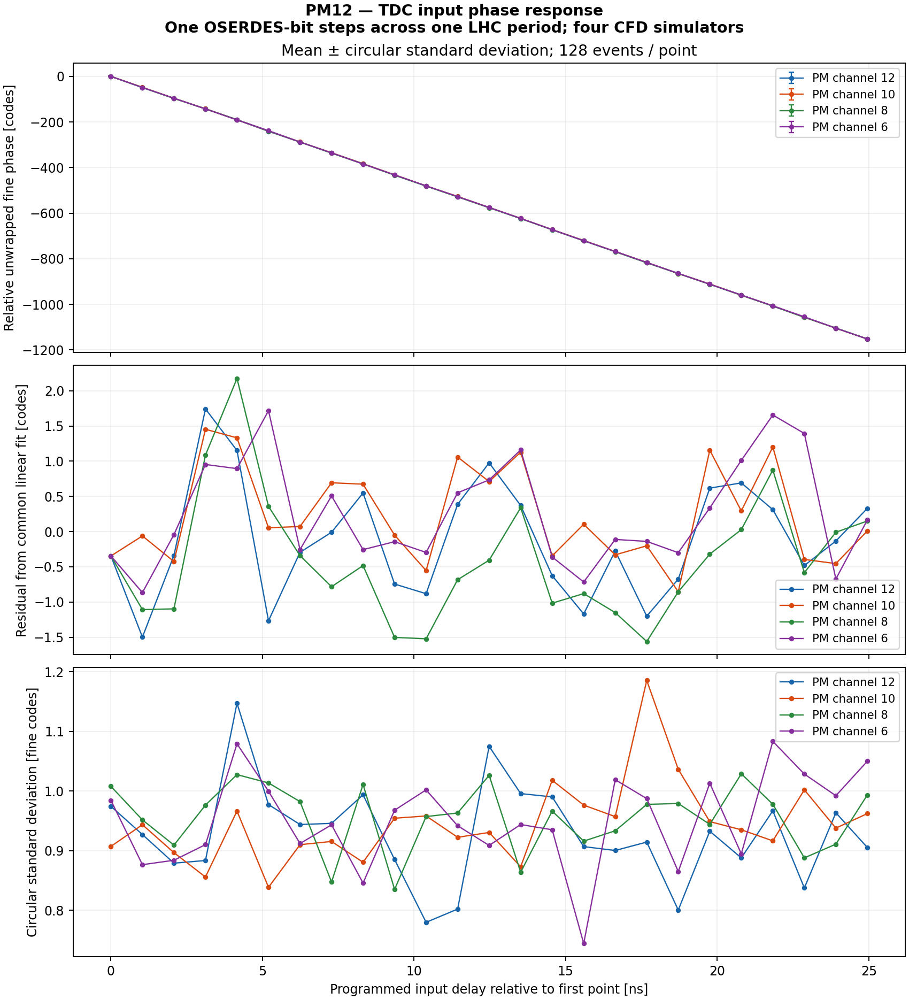
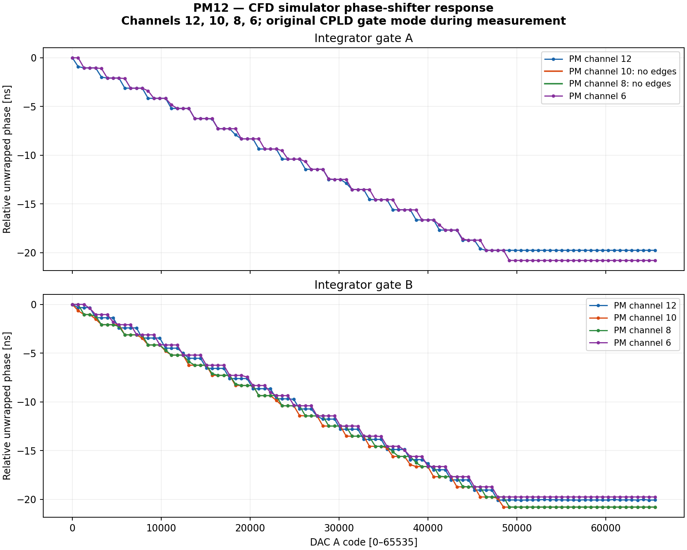

# Four-channel CFD / TDC characterization — 2026-11-10

Board **PM12-K7-3A17A1B402212223**, EEPROM serial1803, physically populated CFD
simulators on channels12,10,8,6. External MOD-DAC-28 was disconnected and the
DMM belonged to another experiment: neither instrument was used or leased.

The existing PM FPGA SRAM diagnostic had been lost after a power cycle. The
qualified c7c42d28 image was restored to SRAM, without a configuration-flash or
MCU write. Kasli was extended from one CFD transmitter port to four selectable
ports while preserving the16 gate-phase receivers, HDMI and private PM bridge.
The new source/build/bitstream and exact raw acquisitions are archived below.

## TDC input-phase result: functional PASS

A16-pulse discovery verified every physical input mapping before scanning.
Each of25 phase positions produced exactly128 events on the selected physical
channel and zero on all other11 channels. All eight quiet windows were empty.
This gives12,800 phase-scan events plus64 discovery events; the raw13-bit buffers
and receipt histograms agree exactly. The legacy single-port script also passed
with16 events on channel12 after the four-port scan.

| Physical PM channel | Slot7 RJ45, zero based | TDC slope [fine codes/ns] | Largest circular spread [fine codes RMS] |
|---|---:|---:|---:|
| 12 | 0 | −46.185 | 1.147 |
| 10 | 1 | −46.201 | 1.185 |
| 8 | 2 | −46.194 | 1.029 |
| 6 | 3 | −46.177 | 1.083 |

Magnitude of the fitted slopes differs by approximately0.051% between extrema.
These are relative fine-code responses, **not independently calibrated TDC time
or intrinsic jitter measurements**. All components of the source/cable/receiver
chain contribute to the observed spread. Fine modulo128 is unwrapped by nearest
continuation; raw coarse fields remain available, without coarse-field repairs.

The input step is one serializer bit: approximately1.0396ns, assuming the supplied
40.0787MHz reference. The scan covers approximately24.951ns. The reference was
not independently measured with a frequency counter.

## Internal DAC-A / gate-phase response

The internal PM DAC-A was swept through101 codes0..65535 for each populated
channel. Kasli recorded all eight gate-return lanes at each point. In total,
404 raw captures contain105,880,320 sampled bits;4,411,680 hardware phase records
were checked against the raw ISERDES samples during acquisition.

| Physical PM channel | Gate A observed span [ns] | Gate B observed span [ns] |
|---|---:|---:|
| 12 | 19.75 | 20.08 |
| 10 | No edges: constant HIGH | 20.79 |
| 8 | No edges: constant HIGH | 20.79 |
| 6 | 20.79 | 19.75 |

The curves flatten near the upper part of the DAC range, around code48,000.
The approximately1.04ns sampling bins limit interpretation of individual steps;
fractional centroids are estimates, not a calibrated fine-delay measurement.

**Unresolved findings:** the INTA return paths for channels10 and8 remain HIGH
throughout the sweep. Their INTB returns respond to the respective DAC writes.
This observation does not locate the fault among the PM driver, CFD simulator,
cable, repeater or Kasli input. It is not a board-wide hardware PASS.

For channel12, the initial20-point scan with the previous INTB-off experimental
CPLD image showed no DAC-dependent movement of its active gate. Temporarily
restoring the original complementary-gate image restored a measurable phase
response. Both the20-point and101-point original-mode scans are preserved.
After the scans, the INTB-off image was restored and vendor-verified on CPLD12.
The other11 CPLD images were unchanged.

The two measurements exercise different paths: DAC-A controls gate timing;
the CFD_SIM LVDS timing input directly supplies the TDC stimulus. TDC phase
sweeps were generated in Kasli, not inferred from the gate DAC setting.

## Resident state and build qualification

- PM FPGA c7c42d28, bitSHA`1dbafd99033f803a086d4153ed3d873adfc9b4208b806785f00d3024bdfbf1ac`.
- Kasli four-port bitSHA`a71a08a258620b0e5a52c5d03aefd8c69040c9d15e8de6391c484ac182b7173b`;
  extension magic`0x43464434` at byte address0xd8. SFP0 control, SFP1 private PM,
  SFP2 LAN bridge, SFP3 unused; bridge enabled.
- Dell Vivado2025.2: WNS0.136ns, hold slack0.068ns, DRC errors0. Four independent
  serializers,18 ISERDES receivers and correct package pins were checked.
- CPLD12 retains INTB-off; internal DAC-A on12/10/8/6 explicitly acknowledged0000.
  All monitor multiplexers inhibited, TCA70/71 disconnected. No B/C/D DAC writes.
- CFD and HDMI outputs off, selector returned to port0, both DIO cards inputs.
  TDC quiet/frozen, all counts0. ADC was not acquired after the PM SRAM restore.
- Fresh FPGA DNA, MCU identity and physical PGOOD checks passed. All leases released.
  No external DAC, DMM, PLL profile, MCU firmware, EEPROM or FPGA flash writes.

The first gateware implementation could not route a shared serializer across
multiple output IOBs; the accepted image uses four serializers. Qualification
also corrected an outdated buffer-count expectation by comparing with the
qualified baseline7 and adding three outputs, for10 total. Initial deployment
hit a Kasli UART permission restriction; the successful deployment bootstrapped
SFP0/PM bridging entirely over IPbus. No UART permissions were changed.

[Editable four-page PDF chapter](evidence-four-cfd-20261110/report.pdf) and
[LaTeX source](evidence-four-cfd-20261110/report.tex).

## Reproduction and evidence

[Wiring, register map, build patch and repeat commands](multi_cfd/README.md).
Reusable acquisition scripts: [gate scan](../cfd_simulator/scan_four_phase.py),
[TDC scan](scan_four_cfd.py), [offline rendering](plot_four_cfd.py).
The gate scanner requires the intended CPLD gate mode to be established first;
it does not silently reprogram CPLDs.

[CSV gate response](evidence-four-cfd-20261110/gate-phase.csv),
[CSV TDC response](evidence-four-cfd-20261110/tdc-phase.csv),
[analysis JSON](evidence-four-cfd-20261110/summary.json),
[validation](evidence-four-cfd-20261110/validation.json),
[raw data and exact executed procedures](evidence-four-cfd-20261110/raw-and-procedures.tar.gz),
[gateware sources, qualified bitstream and reports](evidence-four-cfd-20261110/gateware-artifacts.tar.gz).
