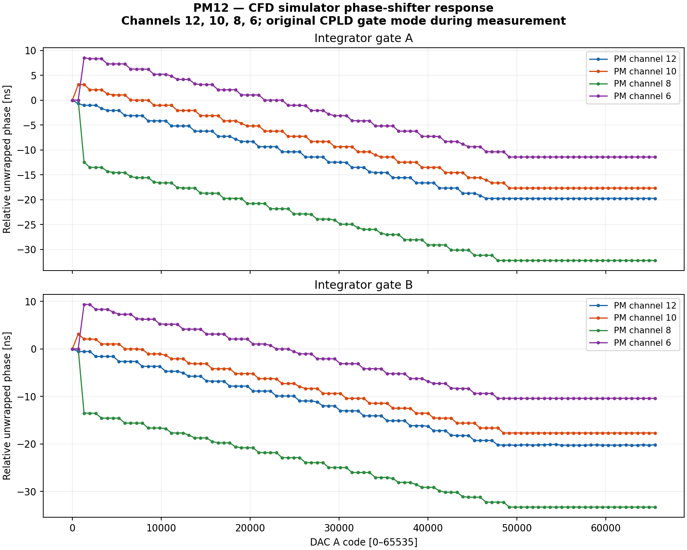
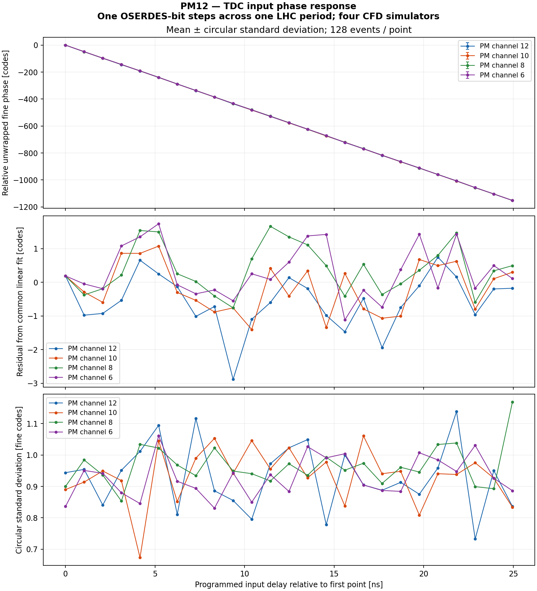

# Post-repair four-CFD repeat — 2026-11-10

The owner repaired short circuits on DIO physical channels5 and9. The repeat
used the same PM12 board **PM12-K7-3A17A1B402212223**, four CFD simulators on
physical channels12/10/8/6 and the same slot7 RJ45 assignments.

**Repair confirmed in the connected CFD fixture:** the two formerly static-HIGH
INTA returns now carry edges and follow their corresponding DAC-A phase setting.
The pre-scan buffers each contained683 rising edges on logical RX10 and RX12,
compared with zero before repair. During the full sweep, **all eight gate-return
lanes had valid edges at all404 DAC points**. This is a functional return-path
repeat; it does not newly qualify every DIO line in both directions at1Gb/s.

## Full repeat results

- Internal DAC-A:101 points per physical channel,0..65535;404 captures total.
- TDC:25 input phases/channel,128 events/phase;12,800 scan events plus64 input
  discovery events. Exactly the expected channel responded; no cross-channel
  records. All eight quiet windows were empty.
- Raw TDC counts/fine histograms independently match all downloaded binary data.
  Hardware phase records were checked against raw ISERDES samples during acquisition.
- External MOD-DAC-28 and the shared DMM were not used or leased.

| Physical PM channel | TDC slope [fine codes/ns] | Gate A span [ns] | Gate B span [ns] |
|---|---:|---:|---:|
| 12 | -46.164 | 19.75 | 20.29 |
| 10 | -46.174 | 20.79 | 20.79 |
| 8 | -46.165 | 32.23 | 33.27 |
| 6 | -46.171 | 19.94 | 19.75 |

The phase axes assume40.0787MHz LHC reference and one serializer bit of about
1.0396ns. These are relative responses; no absolute timestamp or intrinsic
jitter calibration is claimed. Gate phases are sampled in approximately1.04ns
bins. The separate TDC and DAC scans exercise different signal paths.

## Initial phase-step observations

The main sweep contains a simultaneous gate-A/B step between DAC codes655
and1311: approximately−12.48ns and−13.52ns, respectively. This adds roughly
one ADC period to the apparent excursion for channel8. The raw curve is retained;
its32–33ns excursion must not be presented as a continuous tuning range.
Smaller common A/B steps also occur near the start on channel10 (about+3.12ns)
and channel6 (about+8.5..9.36ns). These remain in the raw overlays.
Three local up/down repeats on channel8 (21 additional points) did not reproduce the large
step; adjacent phase changes stayed near one sampling bin. A divider/counter
state change is a plausible interpretation, not an isolated root cause.

## Startup and final state

After the repair/power interruption, diagnostic SRAM images and Kasli startup
clock/SFP enables needed restoration. Existing qualified PMc7c42d28 and Kasli
four-port images were reloaded; no new FPGA build was made. Kasli Si5324 CKIN1
bypass and SFP TX enables were restored using existing station helpers; no
VCO/divider/ICAL or PM CDCE profile change was made. After loading Kasli,
startup used `host.lhc_reference.lhc_bypass(..., enable_sfp2=True)` and
`host.gate_sfp.sfp0_tx(True)`, then restored PM SRAM before verifying IPbus.
This matters after cold startup; TX-disable GPIO defaults must not be assumed
to retain their previous state. All actions held the shared board leases.

CPLD12 original complementary gates were temporarily restored for the DAC scan,
then its INTB-off experimental image was restored and vendor-verified. The other
11 CPLD images were unchanged. All four DAC-A codes were acknowledged0000 at
cleanup, monitor multiplexers inhibited, TCA70/71 disconnected. The other
integrator/injection controls were preserved as observed.

Final CFD/HDMI output enables0, CFD selector0, DIO slot6/7 input directions,
private PM bridge1, valid quiet/frozen TDC buffers with all counts0. Fresh MCU
serial/FPGA DNA and physical PGOOD passed. No ADC acquisition was performed.
No MCU firmware, EEPROM or FPGA configuration flash writes. All leases released.

## Reproduction and retained evidence

The existing [gate scanner](../cfd_simulator/scan_four_phase.py),
[TDC scanner](scan_four_cfd.py) and [plot generator](plot_four_cfd.py) were reused.
The exact CPLD-window wrapper and source snapshots are in the raw archive.
[Prior measurements](FOUR_CFD_CHARACTERIZATION.md) remain unchanged as evidence
of the failed fixture condition.

[PDF chapter](evidence-four-cfd-repaired-20261110/report.pdf),
[editable LaTeX](evidence-four-cfd-repaired-20261110/report.tex),
[gate CSV](evidence-four-cfd-repaired-20261110/gate-phase.csv),
[TDC CSV](evidence-four-cfd-repaired-20261110/tdc-phase.csv),
[validation and before/after counts](evidence-four-cfd-repaired-20261110/validation.json),
[raw data and procedures](evidence-four-cfd-repaired-20261110/raw-and-procedures.tar.gz).
The unchanged bitstreams and gateware sources remain in the
[previous gateware archive](evidence-four-cfd-20261110/gateware-artifacts.tar.gz).
